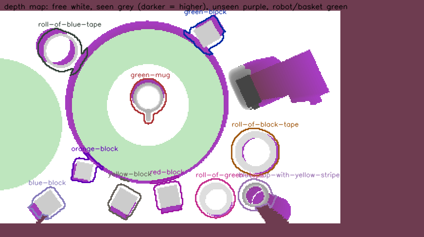

# physAI-arm-ex

A **UR5e** robot arm with an **OnRobot RG6** gripper and a **RealSense**
camera on its wrist handles the twelve items of the lab's order-assembly
task: it picks them up and puts them on the table or into the basket. You
tell it what to do in one of two ways:

* **one action at a time:** you type `(pick-up green-mug)` and the robot does it;
* **a goal:** you type `(in-basket green-mug) (in-basket red-can)` and the
  robot plans the actions itself (with Fast Downward) and does them one after
  the other.

Either way the robot works out the details itself. It looks with the wrist
camera, recognises the items (SAM 3), plans a collision-free motion and
moves. The same programs run the real robot and a Gazebo simulation of the
cell.

Repository: <https://github.com/guyazran/physAI-arm-ex> (it continues the
earlier `lab-tamp` workspace; see [Reference](#reference)).

**Contents**

1. [Run it: four scripts](#run-it-four-scripts)
2. [Build (once)](#build-once)
3. [Run it in simulation](#run-it-in-simulation)
4. [Run it on the real robot](#run-it-on-the-real-robot): the
   [UR driver](#1-the-ur-driver-on-air),
   [the RealSense](#2-the-realsense-on-guest) and
   [the RG6 driver](#3-the-rg6-gripper-driver-on-air)
5. [The action console](#the-action-console)
6. [The goal console](#the-goal-console)
7. [What the robot keeps clear of](#what-the-robot-keeps-clear-of)
8. [Watching it, and when something goes wrong](#watching-it-and-when-something-goes-wrong)
9. [Reference](#reference): how the skills work, `solve.py`, the
   measurements, the simulation, where everything is

---

## Run it: four scripts

Open a terminal for each script and leave each one running. The first
argument always says where to run: **`sim`** (the Gazebo simulation) or
**`real`** (the robot in the lab).

| Terminal | Command | What it starts | Ready when it prints |
|---|---|---|---|
| 1 | `run/1_robot.sh sim` or `real` | the arm and gripper drivers (in `sim`: the whole simulated cell) | `RG6 driver ready` (real: also `Robot connected to reverse interface`) |
| 2 | `run/2_camera.sh sim` or `real` | the wrist camera | sim: `Creating GZ->ROS Bridge`, real: `RealSense Node Is Up!` |
| 3 | `run/3_actions.sh sim` or `real` | the **action console**: you type one action at a time | `Ready.` and the prompt `action>` |
| 3 (instead) | `run/4_goals.sh sim` or `real` | the **goal console**: you type a goal | `Ready.` and the prompt `goal>` |

* Run **either** the action console **or** the goal console, not both: each
  one drives the robot. To switch, quit one (Ctrl-D) and start the other;
  terminals 1 and 2 keep running.
* All terminals must use the same `ROS_DOMAIN_ID`. Each script prints the
  one it uses; the lab PC sets 131 in `~/.bashrc`. Never run the simulation
  and the real robot on the same `ROS_DOMAIN_ID` at the same time.
* The scripts set up everything they need themselves (ROS 2, this workspace,
  the Python environment of SAM 3), so they work from any directory, e.g.
  `~/Workspace/physAI-arm-ex/run/1_robot.sh sim`.
* `--help` after `run/3_actions.sh sim` or `run/4_goals.sh sim` lists the
  options.
* How the scripts were tested (simulation, and the real-robot mode without
  the robot): [verification/README.md](verification/README.md#2026-10-14-the-consoles-and-the-depth-obstacle-model).

## Build (once)

On the lab PC this is done. On another computer that runs the consoles
(Ubuntu 22.04 with ROS 2 Humble):

```console
# ROS packages
sudo apt install ros-humble-desktop ros-humble-ur ros-humble-ros-gz ros-humble-ign-ros2-control \
                 ros-humble-joint-trajectory-controller ros-humble-position-controllers \
                 ros-humble-realsense2-camera python3-pil python3-opencv python3-pip python3.10-venv

# The code
git clone https://github.com/guyazran/physAI-arm-ex.git ~/Workspace/physAI-arm-ex
cd ~/Workspace/physAI-arm-ex

# The Python environment with SAM 3 (it also sees the ROS packages)
python3 -m venv --system-site-packages .venv
echo "numpy<2" > .venv/constraints.txt          # ROS Humble is built against numpy 1
.venv/bin/pip install -c .venv/constraints.txt torch torchvision --index-url https://download.pytorch.org/whl/cu128
.venv/bin/pip install -c .venv/constraints.txt "transformers>=5" accelerate "pillow>=10"
echo "HF_TOKEN=<your Hugging Face token>" > .env

# Fast Downward (only for the goal console; about 2 minutes)
git clone --depth 1 --branch release-24.06.1 https://github.com/aibasel/downward.git third_party/downward
(cd third_party/downward && ./build.py release)
touch third_party/COLCON_IGNORE                  # keep colcon from building it as a ROS package

# The ROS workspace
source /opt/ros/humble/setup.bash
colcon build --symlink-install
```

* SAM 3 (`facebook/sam3`, 3.4 GB) is a gated model: accept its licence on
  Hugging Face before the first run; it is downloaded then. It needs about
  3 GB of GPU memory. Details: [section A.1](#a1-install-once-on-top-of-section-1),
  [section T.1](#t1-install-once-on-top-of-sections-1-and-a1).
* `.venv/`, `.env`, `third_party/`, `build/`, `install/`, `log/` and the
  outputs (`runs/`, `videos/`, logs) are git-ignored.
* The `run/` scripts source ROS 2, `install/setup.bash` and the `.venv`
  themselves; nothing has to go into `~/.bashrc`.
* **After pulling new code,** rebuild with `colcon build --symlink-install`
  if files were added or renamed. Edits to the YAML files and the Python
  code take effect without rebuilding (`--symlink-install`).
* The other two computers (air and guest) need **no build**: see
  [the real robot](#run-it-on-the-real-robot).

## Run it in simulation

In `~/Workspace/physAI-arm-ex`:

```console
run/1_robot.sh sim          # terminal 1: wait for "RG6 driver ready"
run/2_camera.sh sim         # terminal 2
run/3_actions.sh sim        # terminal 3: the action console ...
run/4_goals.sh sim          #             ... or the goal console
```

* The Gazebo window shows the cell. Add `gui:=false` after `sim` in terminal
  1 to run without it.
* The simulated cell starts with **all twelve items on the table**, the
  basket empty and the gripper empty (the scene
  [`problems/all_on_table`](problems/all_on_table)). That is what the goal
  console assumes when it starts.
* Another scene: `run/1_robot.sh sim t_newcell_1` (any directory name in
  `problems/`, `problems_tamp/` or `problems_gen/`).
* **To start again from the beginning,** stop all terminals (Ctrl-C) and
  start them again from terminal 1. The simulation then starts from its scene
  again.
* The simulation runs slower than real time on the lab PC: an action takes
  30 to 60 s.

## Run it on the real robot

**The lab's set-up (2026-10-18).** Three computers on ROS_DOMAIN_ID 131 (the
lab's allocation for this project):

| Computer | Runs | Needs |
|---|---|---|
| **air** (`ssh air@10.10.34.14`) | 1. the UR driver | `ros-humble-ur` (apt) |
| **air**, second terminal | 3. the RG6 gripper driver | this repository (no build) |
| **guest** (`ssh guest@132.68.35.80`) | 2. the RealSense (plugged in there) | `ros-humble-realsense2-camera` (apt) |
| **this PC** | the consoles (SAM 3 needs its GPU) | this repository, [built](#build-once) |

**Before starting any of the drivers,** in every terminal on air and on
guest (their login shells set up neither ROS nor the domain):

```console
source /opt/ros/humble/setup.bash && export ROS_DOMAIN_ID=131
```

### 1. The UR driver (on air)

```console
ssh air@10.10.34.14
source /opt/ros/humble/setup.bash && export ROS_DOMAIN_ID=131
ros2 launch ur_robot_driver ur_control.launch.py ur_type:=ur5e robot_ip:=10.240.10.4 initial_joint_controller:=passthrough_trajectory_controller
```

Then press **Play** on the pendant (program `guy.urp`). Ready when it prints
`Robot connected to reverse interface. Ready to receive control commands.`

* It is the stock driver from apt (`ros-humble-ur`); it does not use this
  repository.
* `passthrough_trajectory_controller`: the robot interpolates each motion
  itself. With the default (scaled) controller air has to stream a setpoint
  every 2 ms; it misses some (no real-time kernel), the robot drops the
  connection and the pendant program stops (driver log: `Connection to
  reverse interface dropped`). Press Play again after that.

### 2. The RealSense (on guest)

```console
ssh guest@132.68.35.80
source /opt/ros/humble/setup.bash && export ROS_DOMAIN_ID=131
ros2 launch realsense2_camera rs_launch.py align_depth.enable:=true rgb_camera.color_profile:=640x360x6 depth_module.depth_profile:=640x360x6
```

Ready when it prints `RealSense Node Is Up!`.

* It is the stock driver from apt (`ros-humble-realsense2-camera`); it does
  not use this repository.
* **640 x 360 at 6 Hz** (instead of the default 1280 x 720 at 30 Hz):
  full-size images do not get across the network. Even these arrive only
  after this PC's UDP receive buffer was raised (needed after every reboot,
  unless made permanent in `/etc/sysctl.d/`):
  ```console
  sudo sysctl -w net.core.rmem_max=2147483647 net.core.rmem_default=33554432 net.ipv4.ipfrag_time=3 net.ipv4.ipfrag_high_thresh=134217728
  ```
  Check: `ros2 topic hz /camera/camera/color/image_raw` on this PC shows
  about 6. 640 x 360 keeps the full field of view (16:9).

### 3. The RG6 gripper driver (on air)

The only driver that needs **this repository**. Once, on air:

```console
git clone https://github.com/guyazran/physAI-arm-ex.git ~/Workspace/physAI-arm-ex
```

Then, each time, in a second terminal on air:

```console
ssh air@10.10.34.14
source /opt/ros/humble/setup.bash && export ROS_DOMAIN_ID=131
cd ~/Workspace/physAI-arm-ex && git pull          # same branch as this PC
python3 src/lab_replica/scripts/rg6_driver.py --ros-args -p backend:=onrobot -p ip:=10.240.10.4 -p port:=41414 -p tool_index:=0 -r /joint_states:=/rg6/joint_states
```

Ready when it prints `RG6 driver ready (onrobot)`.

* **No `colcon build` and no `.venv`:** the script puts `src/lab_replica` on
  the Python path and runs from the source tree. It needs only ROS 2 Humble
  (`rclpy`, `sensor_msgs`, `std_msgs`, `control_msgs`; the last comes with
  `ros-humble-ur`).
* The RG6 works through the OnRobot URCap on the robot (XML-RPC on port
  41414 of the robot's address); nothing has to be installed there.
* Its driver runs on air because air is wired to the robot's network. This
  PC reaches it only over Wi-Fi, where the XML-RPC calls time out and the
  console then finds no gripper reading.
* Run only one RG6 driver: not also `run/1_robot.sh real` on this PC.

### Then, on this PC

* The three computers' clocks differ by up to two hours. The programs here
  judge whether a camera frame is new by when it arrives, not by its time
  stamp, so this does not matter to them.

**The cell** ([`config/cell.yaml`](src/lab_replica/config/cell.yaml)): the
slatted table is 1.26 m x 0.85 m, the robot near its back-left corner, the
blue board (0.70 m x 0.59 m, the workspace) to its right. The world frame's
origin is on the table below the robot's base axis, x towards the board, y
towards the wall (the robot's `base_link` is turned 180 degrees from it).
The wall behind the table is an obstacle (`room.wall_y`); the robot may move
anywhere else above and around the table. The basket may stand anywhere on
the board: the robot finds it in every survey.

**Camera pose (hand-eye calibration).** `wrist_camera` in `cell.yaml` was
calibrated on 2026-10-18. Calibrate again if the camera is moved on the
gripper (the scene must stay still; the camera stays 0.55 m or more above
the table):
```console
python3 src/lab_replica/tools/calibrate_wrist_camera.py capture runs/calib_<date>   # moves the arm through 10 views
python3 src/lab_replica/tools/calibrate_wrist_camera.py solve runs/calib_<date>     # prints the new optical_xyz / optical_rpy
```

**Each time** (in `~/Workspace/physAI-arm-ex`, with `ROS_DOMAIN_ID=131`):

1. Start the UR driver and the RG6 driver on air and the camera on guest
   ([1](#1-the-ur-driver-on-air), [2](#2-the-realsense-on-guest),
   [3](#3-the-rg6-gripper-driver-on-air) above), press **Play** on the pendant. These replace
   `run/1_robot.sh real` and `run/2_camera.sh real` on this PC (those are
   for a set-up where the robot is wired to this PC and the camera plugged
   in here; with `ur_driver: false` in `real_robot.yaml`, `run/1_robot.sh
   real` starts only an RG6 driver).
2. **The scene.** For the goal console: every item on the board, the
   basket empty (anywhere on the board), the gripper empty. Leave at least
   2 cm between items.
3. **On this PC:** the action console **or** the goal console, slowly at
   first:
   ```console
   run/3_actions.sh real --speed-scale 0.3                # the action console, or ...
   run/4_goals.sh real --speed-scale 0.3 --step           # ... the goal console (--step: Enter before every action)
   ```

**Safety.** Keep a hand on the emergency stop. **Ctrl-C** in the console terminal
while an action runs stops the arm and returns to the prompt. Ctrl-C at the
prompt quits. The pendant's speed slider scales every motion, on top of
`--speed-scale`.

## The action console

```text
$ run/3_actions.sh sim
lab-tamp: action console  (simulation)
  connecting to the arm and the gripper ... ok (controller joint_trajectory_controller)
  loading SAM 3 (the segmentation model) ... ok (7 s)
  checking the gripper ... ok (empty)
  waiting for the wrist camera ... ok (1280 x 720)
Ready. Log and camera views: /home/guy/Workspace/physAI-arm-ex/runs/20261013_225357

Actions: (pick-up <item>)   (put-in-basket <item>)   (put-on-table <item>)
Items:   red-can  red-spray-bottle  roll-of-black-tape  roll-of-green-tape  roll-of-blue-tape
         blue-cup-with-yellow-stripe  green-mug  yellow-block  orange-block  blue-block  red-block
         green-block
Example: (pick-up green-mug)   then   (put-in-basket green-mug)
Tab completes names; Ctrl-D quits.
action> (pick-up gren-mug)
invalid action string: unknown item 'gren-mug' (did you mean green-mug?)
            ... (the hints again)
action> (pick-up green-mug)
performing action (pick-up green-mug)
  ... picking up green-mug                          <- one line that shows what it is doing
action success: holding green-mug (width 70 mm)
            ... (the hints again)
action> (put-in-basket green-mug)
performing action (put-in-basket green-mug)
action success: put green-mug at (0.390, 0.070) on the basket
action> (put-on-table red-can)
performing action (put-on-table red-can)
action failed: not applicable: the gripper is empty
```

**Typing an action.** An action is its name and one item, as in
`(pick-up green-mug)`. The parentheses and capital letters do not matter.
Tab completes names, and the arrow keys bring back earlier lines. If the
text is not an action, the answer is `invalid action string: <why>`, and
nothing is sent to the robot.

**The actions:**

| Action | Possible when | What the robot does |
|---|---|---|
| `(pick-up X)` | the gripper is empty | looks from above (and from the front if it does not recognise X from above), finds X, looks at it from closer, grasps it, lifts it, returns home |
| `(put-in-basket X)` | the gripper holds something | looks, finds the emptiest spot in the basket, drops X there from just above the rim (it may land on other items), returns home |
| `(put-on-table X)` | the gripper holds something | looks, puts X down on the free table spot nearest to where it was picked up, returns home |

**The answer.** `performing action` is printed at once. One line then shows
what the robot is doing, and when it has finished:

* `action success: <what it did>`, or
* `action failed: <reason>`. A refused action (not possible now, item not
  found, no collision-free motion) has not moved anything. A failure during
  a motion says what happened, e.g. that the item slipped out of the gripper.

The robot checks for itself whether the gripper holds something (the RG6's
grip sensor). It assumes nothing else about the state: it looks before
every action.

**Options:** `--speed-scale S` (slower or faster motions), `--no-home`
(stay where the action ended), `--verbose` (print every step, not only the
current phase), `--save-frames` (also save every camera image, for
[debugging](#watching-it-and-when-something-goes-wrong)).

## The goal console

```text
$ run/4_goals.sh sim
lab-tamp: goal console  (simulation)
  connecting to the arm and the gripper ... ok (controller joint_trajectory_controller)
  loading SAM 3 (the segmentation model) ... ok (5 s)
  checking the gripper ... ok (empty)
  waiting for the wrist camera ... ok (1280 x 720)
Ready. Log and camera views: /home/guy/Workspace/physAI-arm-ex/runs/20261013_231313

State:   on the table: red-can  red-spray-bottle  roll-of-black-tape  roll-of-green-tape
                       roll-of-blue-tape  blue-cup-with-yellow-stripe  green-mug  yellow-block
                       orange-block  blue-block  red-block  green-block
         in the basket: nothing
         gripper: empty
Goal:    facts that must all hold at the end, for example
           (in-basket green-mug)
           (in-basket red-can) (robot-gripping green-mug)
           (and (in-basket red-block) (or (in-basket blue-block) (on-table green-block)))
Facts:   (on-table <item>)  (in-basket <item>)  (robot-gripping <item>)  (robot-gripper-empty)
         combined with and, or, not, imply, forall, exists  (e.g. (not (on-table red-can)))
Items:   red-can  red-spray-bottle  roll-of-black-tape  roll-of-green-tape  roll-of-blue-tape
         blue-cup-with-yellow-stripe  green-mug  yellow-block  orange-block  blue-block  red-block
         green-block
Commands: state (show the state), reset (all items on the table, gripper empty), quit. Tab completes names.
goal> (in-basket red-can) (in-basket gren-block)
invalid goal: (in-basket gren-block): unknown item 'gren-block' (did you mean green-block or red-block?)
            ... (the state and the hints again)
goal> (in-basket red-can) (robot-gripping yellow-block)
goal: (and (in-basket red-can) (robot-gripping yellow-block))
planning ...
plan (3 actions):
  1. (pick-up red-can)
  2. (put-in-basket red-can)
  3. (pick-up yellow-block)
performing action 1/3: (pick-up red-can)
action success: holding red-can (width 56 mm)
performing action 2/3: (put-in-basket red-can)
action success: put red-can at (0.370, 0.040) on the basket
performing action 3/3: (pick-up yellow-block)
action success: holding yellow-block (width 50 mm)
goal reached (3 actions; the state is what they should have produced)
            ... (the state, now with red-can in the basket and yellow-block in the gripper)
goal> (on-table red-can)
goal: (on-table red-can)
planning ...
the goal cannot be reached from this state: (on-table red-can) can never hold (items in the basket never leave it; the gripper holds one item at most)
```

**Typing a goal.** A goal is one or more facts that must all hold at the
end. A fact is one of these, with one of the twelve item names:

| Fact | Means |
|---|---|
| `(on-table X)` | X is on the table |
| `(in-basket X)` | X is in the basket |
| `(robot-gripping X)` | the robot holds X |
| `(robot-gripper-empty)` | the robot holds nothing |

Facts can be combined with `and`, `or`, `not`, `imply`, `forall` and
`exists`, as in PDDL:

```text
(in-basket green-mug)                                    one fact
(in-basket red-can) (robot-gripping green-mug)           several facts: all of them
(and (in-basket red-block) (not (on-table blue-block)))  and, not
(or (in-basket red-can) (in-basket green-mug))           either one
(forall (?x - item) (in-basket ?x))                      every item in the basket
```

A misspelt name is reported with a suggestion (`invalid goal: ...`). A path
to a `.pddl` problem file also works: its `(:goal ...)` is used.

**What happens then.** The console plans the shortest sequence of actions
from the current state (Fast Downward), prints it, and performs the actions
one by one, as the action console would: `performing action 1/3: ...`,
then `action success: ...` or `action failed: ...`. At the end it prints
`goal reached`. If an action fails, it stops there and prints
`goal not reached`.

**The state.** The console starts from *every item on the table and the
gripper empty*. After each successful action it updates the state with that
action's effect. It does not look to check facts such as `in-basket`, so:

* After a failed action, the state is the one before that action. A refused
  action has not moved anything. If the gripper sensor disagrees with the
  state, the console says so.
* If you move items by hand, or an item bounces out of the basket, the state
  is wrong. Type `reset` (every item on the table, the gripper empty) after
  putting everything back on the table, or restart the console.
* Items never leave the basket (the PDDL domain has no action for it). A
  goal such as `(on-table red-can)` after the can went into the basket is
  answered with `the goal cannot be reached from this state`.

**Commands at the prompt:** `state` (show the state), `reset`, `quit` (or
Ctrl-D).

**Options:** `--step` (press Enter before every action of a plan; `n` stops),
and the same options as the action console.

## What the robot keeps clear of

The motion planner does **not** use the items' 3D models as obstacles. The
robot only estimates an item's place from above (position, rotation, which
side it rests on), and the real item may be a little elsewhere, lean
against something, or have a part the model lacks. So every motion keeps
clear of **what the camera actually measured**:

* Each look turns the depth image into a **height map** of the table (2.5 mm
  cells). Each cell is an obstacle from the table up to the highest point
  seen there.
* Space the camera **could not see** counts as occupied. This includes the
  space behind tall items, outside the image, and holes in the depth.
  It is filled up to the lowest height at which a camera ray passed through
  it (rays only pass through empty space, and things stand on the table).
  Where no ray passed, it is filled up to 30 cm (`max_item_height` in
  [`config/perception.yaml`](src/lab_replica/config/perception.yaml)).
* The robot itself, the item in its gripper and the basket's wall are taken
  out of the depth. The table, the basket and the wall behind the table
  (`room.wall_y` in `cell.yaml`, kept 3 cm clear) are the only modelled
  obstacles.
* The item models are still used to choose where to grasp an item and where
  an item fits. They also label the cells of each item: the fingers may
  touch the item being picked up, and its cells are dropped once it is in
  the gripper. **Everything else the camera saw is an obstacle**, whether it
  was recognised or not.
* Two exceptions, because the camera cannot see these items: the item **in
  the gripper** is checked as its model's box, held where it was grasped;
  and an item **just put down** is checked as its model's box until the
  next look.
* With an item in the gripper, the camera views are taken up to 6 cm
  higher, until the item hangs at least 3 cm above the 30 cm that unseen
  space is filled up to. (This mattered when the camera was thought to be
  tilted 30 degrees, so the gripper leaned to look down; the calibrated
  camera looks along the gripper axis, but tilted views such as the
  recognition view still lean it.)

Each look saves a top view of this map in the run directory (below). Here
the robot is holding the red can. Grey cells are what the camera saw (darker
= higher), purple cells were not seen (shadows behind tall items, strips
outside the view), and the coloured outlines are the recognised items:



This is more cautious than planning around models. A grasp that needs the
fingers to fit into a narrow gap between items can be refused, and an item
is put down away from places the camera could not see. And whatever really
is in the way blocks the robot: for example the spray bottle, dropped into
the basket, can land leaning over the rim towards the robot, and the robot
then refuses motions that would pass there until it is set upright.

## Watching it, and when something goes wrong

* **What the robot saw:**
  `ros2 run rqt_image_view rqt_image_view /lab_skills/detections` shows
  what SAM 3 found, and for a put, where the item goes.
* **The run directory** (printed at `Ready.`, under `runs/`) holds, for
  every look:
  * `console.log`: every step of every action;
  * `*_depth_map.png`: the obstacle map above;
  * `*.jpg`: the camera views with the recognised items, and the put plans;
  * `*_survey.yaml`: the perceived item positions;
  * `frame_*.npz`: the raw camera images, with `--save-frames`.
* **Replaying saved frames** offline, without the robot. In
  `~/Workspace/physAI-arm-ex`, with the frames of one action (e.g. its top view,
  front view and closer look):
  ```console
  source /opt/ros/humble/setup.bash && source install/setup.bash && source .venv/bin/activate
  python3 src/lab_replica/tools/depth_map.py runs/<run>/frame_A.npz runs/<run>/frame_B.npz --pick red-can
  ```
  It prints what SAM 3 finds and why a grasp is refused, and writes the
  depth map.

| Message | What to do |
|---|---|
| `no arm: ... Is the robot running?` | start terminal 1 (real: press Play on the pendant); check `ROS_DOMAIN_ID` |
| `no camera images on /camera/camera/...` | start terminal 2; check `ros2 topic hz /camera/camera/color/image_raw` |
| `No RealSense devices were found!` (terminal 2) | the camera is not plugged in, or not into a USB 3 port; replug it, then restart terminal 2 |
| `invalid action string: ...`, `invalid goal: ...` | a typo: the message says what is wrong |
| `action failed: X not found` | SAM 3 did not recognise X (e.g. hidden behind a taller item); look at the camera view in the run directory; the prompts are in `config/perception.yaml` |
| `action failed: cannot pick X: ... hits Y` | no collision-free grasp, given what the camera saw; look at the depth map; move items a little apart |
| `action failed: not applicable: the gripper is empty` (or `... is holding ...`) | the gripper sensor says the action is not possible now |
| `the goal cannot be reached from this state` | items never leave the basket, and the gripper holds one item at most |

---

## Reference

> **The cell changed on 2026-10-18** (slatted 1.26 x 0.85 m table, 0.70 x
> 0.59 m board, robot base turned 180 degrees, basket anywhere on the board,
> calibrated wrist camera looking along the gripper axis, wall as an
> obstacle; see [Run it on the real robot](#run-it-on-the-real-robot) and
> `config/cell.yaml`). The sections below were written for the earlier cell:
> their commands still apply, but numbers, photos and scene names
> (`hardcoded_problem`, `problem_006xx`, the video tasks) refer to it. Those
> scenes are kept in `problems*/old_cell_2026-10-13/`; their worlds no
> longer match `cell.yaml`.

The rest of this README is the reference. Most of it was written before the
consoles: it describes the skills in detail (section A), the all-in-one
`solve.py` (section T), and the simulated cell, its measurements and the code
(sections 1-6).

The robot code grew in three steps: **lab-replica** (the Gazebo replica of
the cell with a hard-coded solution, a problem generator and every
measurement), then **lab-skills** (single PDDL actions executed autonomously
with the wrist camera and SAM 3), then **lab-tamp** (goals planned with Fast
Downward). All of it is still here. ROS 2 Humble, Ignition Gazebo Fortress,
`ur_robot_driver`, PyTorch and Transformers (SAM 3) in a virtual environment,
Fast Downward.

| I want to ... | Go to |
|---|---|
| plan and execute a goal in one command, in a new random scene, with a ground-truth check | [T.2](#t2-solve-a-goal) |
| know how the planning and execution fit together | [T.3](#t3-how-it-works) |
| execute single actions from my own program (ROS 2 action) | [A.2](#a2-execute-actions-in-simulation) |
| know how the skills work and what they assume | [A.3](#a3-how-it-works), [A.4](#a4-assumptions) |
| see the verification of the skills and the videos | [A.6](#a6-verification-and-videos) |
| run the hard-coded solution in simulation | [Run in simulation](#2-run-in-simulation) |
| fix a dimension so the simulation matches the lab | [Make the simulation match reality](#4-make-the-simulation-match-reality) |
| find the code of an object | [Where everything is](#5-where-everything-is) |

---

## T. Task and motion planning: solve a goal

### T.1 Install (once, on top of sections 1 and A.1)

Fast Downward, built in the workspace (git-ignored, about 2 minutes):

```console
cd ~/Workspace/physAI-arm-ex
git clone --depth 1 --branch release-24.06.1 https://github.com/aibasel/downward.git third_party/downward
(cd third_party/downward && ./build.py release)
touch third_party/COLCON_IGNORE          # keep colcon from building it as a ROS package
colcon build --symlink-install
```

Another Fast Downward can be used by setting `FAST_DOWNWARD` to its
`fast-downward.py`.

### T.2 Solve a goal

One command (with the workspace sourced and `source .venv/bin/activate`):

```console
ros2 run lab_replica solve.py "<goal>" [--scene <problem>] [--headless]
```

It writes the task to `problems_tamp/<name>/`, plans with Fast Downward,
starts the simulation (with the Gazebo window unless `--headless`) and the
skill server, executes the plan action by action, checks the goal against the
simulator's ground truth, writes `result.json` and shuts everything down
(`--keep-running` keeps the simulation up until Ctrl-C).

**The goal** is a PDDL goal formula over the domain's predicates
(`on-table`, `in-basket`, `robot-gripping`, `robot-gripper-empty`) and the
twelve items, or a `.pddl` problem file whose `(:goal ...)` is taken (its
`:objects` must be the twelve items; its `:init` is ignored):

```console
ros2 run lab_replica solve.py "(in-basket green-mug)"
ros2 run lab_replica solve.py "(in-basket green-mug) (robot-gripping red-can)"          # facts: a conjunction
ros2 run lab_replica solve.py "(and (in-basket roll-of-blue-tape) (or (in-basket red-can) (in-basket green-mug)))"
ros2 run lab_replica solve.py "(forall (?x - item) (not (on-table ?x)))"                # and, or, not, imply, forall, exists
ros2 run lab_replica solve.py reference/000001_problem.pddl
```

A misspelt item or predicate is reported with a suggestion before anything
starts.

**The initial state** comes from the scene:

| | Scene |
|---|---|
| (default) | a new random scene: a stable layout like `generate_problem.py` makes (settled and checked in Gazebo, every table item graspable), some items in the basket, maybe one in the gripper; sampled until the goal is reachable from it (about 30 s). Options: `--seed S`, `--basket-items K` (default random 0-3), `--p-holding P` (default 0.3), `--randomize-basket`, `--no-render` |
| `--scene <problem>` | the scene of an existing problem or task directory: a name in `problems/`, `problems_tamp/` or `problems_gen/`, or a path. Its `world.sdf` and its initial state |

A goal that cannot be reached from the scene's initial state is refused
(items never leave the basket in this domain, and the gripper holds one item
at most), and so is a goal that can never hold.

More options: `--plan-only` (write the task and the plan, execute nothing),
`--name NAME` (default `task_<date>_<time>`), `--step` (Enter before every
action), `--domain ID` (ROS_DOMAIN_ID for everything started here),
`--speed-scale S`, `--time-limit` (Fast Downward, default 60 s); see `--help`.

**Run a task again** (same scene, same goal; it is replanned):

```console
ros2 run lab_replica solve.py --task <name>
```

**Or step by step**, with the simulation and the skill server in their own
terminals (to watch them, or to keep the simulation between tasks; the
scene must be the task's):

```console
ros2 run lab_replica solve.py "<goal>" --plan-only --name mytask     # prints the plan
ros2 launch lab_replica sim.launch.py problem:=mytask
ros2 run lab_replica skill_server.py --sim                           # in the .venv
ros2 run lab_replica solve.py --task mytask --attach
```

A task directory (`problems_tamp/<name>/`):

| File | |
|---|---|
| `problem.pddl`, `domain.pddl` | the PDDL problem given to the planner: the twelve items, the scene's initial state, the goal; the domain (always config/domain.pddl) |
| `plan.txt`, `planner.log` | Fast Downward's plan and output |
| `world.sdf`, `layout.yaml`, `layout.png`, `render.png` | the scene: the Gazebo world, where every item stands (and the init, goal, plan), a top view, the lab camera's view |
| `README.md` | the task, the plan, the commands, where to put the items on the real table |
| `result.json` | the last execution: every action with the skill server's answer and duration, the true state afterwards and whether the goal holds |
| `logs/` | output of the simulation and the skill server started by `solve.py` |

A task directory is a scene too (`--scene <task>`), for another goal in the
same layout.

### T.3 How it works

```
 goal (text or .pddl) ──► check against domain + items ─┐
 scene (generated / existing) ──► initial state ────────┴──► problem.pddl ──► Fast Downward ──► plan
                                                                                                 │
 for each action: /lab_skills/execute ──► skill server: look, recognise, plan motion, act ◄──────┘
                                         (section A; stops at the first failed action)
 afterwards (simulation): the true state from Gazebo ──► does the goal hold?
```

* **Task planning** (`lab_replica/tamp/fast_downward.py`): optimal A* with
  LM-cut. A goal with a disjunction or a quantifier makes the translator
  introduce axioms, which LM-cut does not support; the search is then
  repeated with blind A* (still optimal; this domain has a few ten thousand
  states, so either takes well under a second).
* **Scenes** (`lab_replica/tamp/task.py`): a generated scene uses the problem
  generator's layout sampler (section 5) with one addition: an initial state
  is only accepted if Fast Downward can reach the goal from it, checked
  before the expensive steps (graspability, settling in Gazebo).
* **Execution** (`lab_replica/tamp/execute.py`): the actions go one by one to
  the skill server of section A, which knows nothing of the plan or the
  layout: every action looks at the scene itself. `solve.py` tracks the PDDL
  state the plan should produce, compares the gripper contents the skill
  server reports with it, and stops at the first action that fails (a refused
  action leaves the scene unchanged; the task can be continued by hand with
  `do_action.py`).
* **An item held in the initial state** stands on the table in the simulated
  world (it cannot start in the gripper), so it is picked up first with a
  setup `(pick-up X)`, unless the gripper already holds something
  (`--no-setup` skips it).
* **Ground truth** (`lab_replica/tamp/sim_truth.py`, same rules as
  `tools/verify_actions.py`): after the plan, the item poses and the grip
  from Gazebo give the true PDDL state, which is checked against the goal.
  The robot never sees it.

### T.4 On the real robot

For goals on the real robot, the [goal console](#the-goal-console) is the
simpler way. `solve.py` can drive it too: set the items up as in the task's
README.md (generated scenes give every item's place), start the robot and
the camera ([Run it on the real robot](#run-it-on-the-real-robot), terminals
1 and 2), then:

```console
ros2 launch lab_replica real.launch.py                       # then Play on the teach pendant
ros2 run lab_replica skill_server.py --speed-scale 0.3       # in the .venv
ros2 run lab_replica solve.py --task <name> --attach --step
```

Without the simulator there is no ground truth: `solve.py` reports the
actions only. If the initial state has an item in the gripper, put it in the
gripper yourself and add `--no-setup`, or leave it on the table at its place
and the robot picks it up first.

### T.5 Videos

(`videos/` is git-ignored: the recordings are only in the lab PC's copy.)

[`videos/tamp/`](videos/tamp) shows tasks solved from start to end, each with a
`.json` of every action's result and the ground-truth check. The video shows
the lab camera's view; top left the goal and the plan (done / running /
failed); insets: the wrist camera live and the robot's last annotated view;
caption: the current action and what the robot is doing; at the end, whether
the goal holds in the simulator. A setup pick-up (an item in the gripper in
the initial state) is not recorded: the video starts with the item held.
Recorded with:

```console
ros2 run lab_replica solve.py "<goal>" --plan-only --name <task>
python3 src/lab_replica/tools/record_task.py <task> videos/tamp/<name>.mp4      # in the .venv; about 3 min per action
```

| Video | Task | Goal | Scene | Result |
|---|---|---|---|---|
| `01_two_items_into_basket` (101 s) | video_05 | `(and (in-basket red-can) (in-basket roll-of-black-tape) (robot-gripper-empty))` | generated, seed 901, empty basket | 4/4 actions, goal holds |
| `02_negation_and_disjunction` (116 s) | video_03 | `(and (not (on-table red-spray-bottle)) (or (in-basket green-block) (in-basket yellow-block)) (robot-gripper-empty))` | generated, seed 903 | 4/4, goal holds (blind A*: the `or` makes axioms); the 27 cm spray bottle is dropped into the basket |
| `03_cup_into_basket_ends_holding_can` (80 s) | video_04 | `(and (in-basket blue-cup-with-yellow-stripe) (in-basket green-mug) (robot-gripping red-can))` | generated, seed 904, the mug already in the basket | 3/3, goal holds |
| `04_drop_held_roll_then_hold_mug` (96 s) | video_06 | `(and (on-table blue-block) (in-basket orange-block) (robot-gripping green-mug))` | problem_00600, starts holding the black tape roll | 4/4 (first frees the gripper), goal holds |
| `05_green_tape_into_basket_then_hold_mug` (97 s) | video_02 | `(and (on-table blue-block) (in-basket roll-of-green-tape) (robot-gripping green-mug))` | problem_00600 | 4/4, goal holds |
| `06_stopped_held_roll_would_hit_mug` (68 s) | video_01 | as 01 | generated, seed 917, empty basket | stopped at action 3 (a refusal, nothing moved): the black tape roll (10.5 cm) lies next to the mug; the planner checks the held roll as a box, whose corners would touch the mug on the lift |

Recorded again on 2026-10-13 with the measured cell (the scenes are new: the
same goals and seeds give other layouts with the new sizes;
`videos/tamp/before_measurements/`: the earlier recordings). Two fixes came
out of it: the highest transit height is now 0.74 m (was 0.66; the 27 cm
spray bottle, held at its head, has to be carried at 0.69 m to clear the
basket rim), and the wall-clock timeout of a trajectory allows a simulation
running at 1/4 of real time (a 14 s motion at 0.3 x real time timed out).

### T.6 Known limitations

* No replanning: the plan is followed open loop at the task level, and the
  first failed action ends the run. The PDDL state afterwards is the one
  the actions *should* have produced; nothing perceives facts such as
  `in-basket` (an item bouncing out of the basket goes unnoticed until the
  ground-truth check, in simulation only).
* The domain is used unchanged, so its limits are the task's: items are
  never taken out of the basket, and `put-in-basket` always drops (section
  A.3), whatever is already in there.
* Motion feasibility is only known when an action runs (the skill server
  plans each motion from what it sees); a plan whose actions are all
  applicable in PDDL can still have an action refused (e.g. an item the
  camera does not recognise, section A.7).

## A. Autonomous PDDL actions

### A.1 Install (once, on top of section 1)

The perception runs in a Python virtual environment that also sees the ROS
packages:

```console
sudo apt install python3-pip python3.10-venv
cd ~/Workspace/physAI-arm-ex
python3 -m venv --system-site-packages .venv
echo "numpy<2" > .venv/constraints.txt          # ROS Humble is built against numpy 1
.venv/bin/pip install -c .venv/constraints.txt torch torchvision --index-url https://download.pytorch.org/whl/cu128
.venv/bin/pip install -c .venv/constraints.txt "transformers>=5" accelerate "pillow>=10"
colcon build --symlink-install
```

SAM 3 (`facebook/sam3`, 3.4 GB) is a gated model: accept its licence on
Hugging Face and put `HF_TOKEN=<token>` in `~/Workspace/physAI-arm-ex/.env`
(git-ignored). It is downloaded on first use. It needs about 3 GB of GPU memory.

### A.2 Execute actions in simulation

Three terminals (each: `source install/setup.bash`; the second one also
`source .venv/bin/activate`):

```console
ros2 launch lab_replica sim.launch.py problem:=problem_00600      # any problem, or none for the empty cell
ros2 run lab_replica skill_server.py --sim                         # loads SAM 3, then: ready: /lab_skills/execute
ros2 run lab_replica do_action.py "(pick-up green-mug)" "(put-on-table green-mug)"
```

`do_action.py` prints what the robot is doing and `OK: ...` or
`FAILED: <reason>`, and stops at the first failure. The same action can be
sent from any ROS 2 program (this is what a plan executor uses):

```console
ros2 action send_goal /lab_skills/execute lab_skills_msgs/action/ExecuteAction "{action: '(put-in-basket green-mug)'}"
```

| Action | Applicable when | What the robot does |
|---|---|---|
| `(pick-up X)` | the gripper is empty | survey (top view; also the front view if X is not recognised from above), find X, look at X from closer, grasp, lift, return home |
| `(put-in-basket X)` | the gripper holds something | survey, measure how high things are piled in the basket, drop X from just above the rim over its emptiest spot (it may land on other items), return home |
| `(put-on-table X)` | the gripper holds something | survey, put X on the free table spot nearest to where it was picked up (or `--at X Y`), return home |

"Empty" and "holds something" come from the gripper's grip-detected flag;
nothing else of the PDDL state is assumed. An action is refused (and nothing
moves) when it is not applicable, when X is not found, or when no
collision-free grasp or free table spot exists (put-in-basket is not refused
for lack of room: items are never taken out of the basket, so X is dropped
onto whatever is there). While running, the server publishes
`/lab_skills/status` (the current phase) and `/lab_skills/detections` (the
annotated camera view: for a pick-up what SAM 3 found; for a put the plan,
i.e. the basket's pile heights and the drop spot, or the free table spot and
what it keeps clear of), and saves every annotated view and the perceived
scene (YAML) under `runs/<date>/` (`--save-frames` also saves the raw RGB-D
frames).

### A.3 How it works

```
 survey (top view) ──► SAM 3: every item by name ──► masks + depth ──► item poses ┐
 front view (pick-up, if the target is not recognised from above) ────────────────┤
 close look at the target (pick-up only) ─────────────────────────────────────────┤
 depth not explained by any item ──► unknown obstacles ───────────────────────────┤
                                                                                  ▼
                     collision-checked grasp / placement (planning/skills.py) ──► arm + gripper ──► grip check
```

* **Camera.** The RealSense sits at the wrist, level with the joint between
  the robot and the gripper, its lens 110 mm off the gripper axis (measured),
  its view tilted 30 deg away from the fingers so they never appear in the
  image (the tilt is assumed, not measured) (cell.yaml `wrist_camera`; the camera is part of the
  robot's collision model). Its pixels go to the world through the arm's joint
  angles and this hand-eye transform; frames are only taken with the arm at
  rest.
* **Survey.** One view straight down from 0.70 m covers the whole placement
  region: the best geometry, and it sees into the basket, which is all a put
  needs. Some items are hard to name from straight above (the spray bottle is
  a grey head on a red blob), so before a pick-up whose target the top view
  did not recognise (score below 0.5) the camera also looks at the same
  region at an angle from the front, where SAM 3 recognises them; the
  geometry still comes from the top view. Before a pick the camera also looks
  straight down at the target from 0.50 m. Views are in
  config/perception.yaml.
* **Recognition.** SAM 3 is asked for every item by name (one image encoding,
  13 prompts, about 0.7 s on the RTX 3070 Ti). A name can match several objects
  and an object several names (from some angles the spray bottle's body is "a
  red block"), so every mask is turned into 3D points, the item's pose is
  fitted with the item's known shape (perception/estimate.py), and the mask is
  scored by SAM's confidence times how well height and size match. Masks are
  then assigned to items best first, one each. A mask that covers only part of
  an item (the bottle without its grey head, the mug without its handle) is
  grown to the connected depth points around it.
* **Pose fitting** (items.yaml dimensions): the resting pose from the height;
  round items by a circle of the known radius through the top outline; blocks
  and a lying can by a rectangle; the mug's yaw from its handle (found in the
  depth around the body); the spray bottle by its trigger head (grasped) and
  its nozzle side from the body. In simulation: 0.1-2 mm and under 1 deg from
  the straight-down view.
* **Obstacles: what the camera saw.** The motions keep clear of the depth
  seen, not of the item models (see
  [What the robot keeps clear of](#what-the-robot-keeps-clear-of); code:
  `autonomy/depth_world.py`). An item SAM 3 missed is avoided like any other,
  and nothing is put down on it. A put on the table only uses spots that the
  camera's view covers up to the item's top, so that the item can be seen,
  and picked up, again.
* **Dropping into the basket.** The depth inside the basket becomes a height
  map (so items nobody recognised count too). The drop spot is the one with
  the lowest pile under the item's footprint, then the most room around it,
  with the footprint over the basket floor (not leaning on the wall). The
  item is released with its bottom 2 cm above the rim (or above the pile
  there, if higher) and falls; only the robot and the item on its way down
  are kept clear of the basket's contents. If the motion to one spot is
  blocked, the next best spots are tried. A drop can tip or bounce items,
  which is intended: the state after a put-in-basket is for perception to
  find out.
* **Motion.** The collision-checked top-down grasps and placements of
  lab-replica (planning/skills.py), now fed with the perceived scene, and
  with the depth map as the obstacles (`autonomy/obstacles.py`
  `PerceivedSkills`). Changed for this: a held item moves rigidly with the
  gripper (it leans when the gripper leans for a camera view), its box is
  checked with 45 points instead of 12, and it may only go below the basket
  rim over the basket when it is being put in (or picked from) the basket.

Code: `lab_replica/perception/` (camera, SAM 3, pose fitting, scene),
`lab_replica/autonomy/` (the executive, camera views, unknown obstacles),
`scripts/skill_server.py`, `scripts/do_action.py`, `src/lab_skills_msgs/`
(the action). Tools: `tools/verify_actions.py` (A.6), `tools/record_action.py`
(videos).

### A.4 Assumptions

Made so that the simulation and the real robot differ as little as possible:

* The camera is a RealSense publishing colour and depth **aligned to colour**
  under the realsense2_camera names (`/camera/camera/color/image_raw`,
  `/camera/camera/aligned_depth_to_color/image_raw`,
  `/camera/camera/color/camera_info`); depth as 16UC1 mm (the driver) or 32FC1 m
  (Gazebo). The simulated one is D435-like: 1280 x 720, 69 deg wide, depth from
  0.17 m. The views keep every item at least 0.28 m from the camera, inside a
  real D435's depth range.
* The camera is mounted as in cell.yaml `wrist_camera` (a hand-eye
  calibration measures exactly that pose).
* The twelve items are the known ones of items.yaml, resting in one of their
  stable poses, at least 2 cm apart (as the generator makes them). An item
  leaning on another (e.g. in the basket) is not given a pose: it is an
  unknown obstacle. The item models are used to find grasps and free spots,
  never as obstacles.
* Things stand on the table (or in the basket): the space above a measured
  surface, or above a height where a camera ray passed, is empty.
* Grasps are top-down, as in lab-replica.

### A.5 On the real robot

See [Run it on the real robot](#run-it-on-the-real-robot) for the four
scripts. For the skill server of A.2: the same commands with `real.launch.py`
instead of `sim.launch.py` and `skill_server.py` without `--sim` (start with
`--speed-scale 0.3`). Before that:

1. **Mount the camera** on the RG6 and run the RealSense driver with aligned
   depth (`run/2_camera.sh real`, or
   `ros2 launch realsense2_camera rs_launch.py align_depth.enable:=true` on any
   machine of the ROS domain; check the topic names against
   config/perception.yaml).
2. **Hand-eye calibration**: put the measured pose of the colour optical frame
   in rg6_base_link into cell.yaml `wrist_camera.optical_xyz/optical_rpy` (the
   values there are the design of the simulated bracket). Check it with
   `--save-frames` and `tools/depth_map.py`: the table must come out at z = 0
   (white in the depth map) and the items where they are.
3. **Check the survey views** with the real lens: each view must see the
   whole placement region (the server's annotated views show what it saw). A
   D455 (90 deg) sees more; a narrower lens may need a third view.
4. Measure the items (items.yaml) and the table height: the pose fitting uses
   the item dimensions, the planner the table.

### A.6 Verification and videos

`tools/verify_actions.py` runs actions in freshly generated problems and checks
each one against the simulator's ground truth, which the robot never sees: the
PDDL facts afterwards are exactly the action's effect, and no other item moved
more than 2 cm or tilted more than 10 deg (items already in the basket that a
drop pushes around are listed, not counted as a failure, unless knocked out).

Current version (drops into the basket, top-view survey, 16-sided round
items): 41 actions in 4 problems:

| action | executed | verified | refused (nothing moved) | failed |
|---|---|---|---|---|
| pick-up | 25 | 17 | 7 | 1 |
| put-in-basket | 10 | 10 | 0 | 0 |
| put-on-table | 6 | 6 | 0 | 0 |

Mean time per action 33 s (was 64 s). Seven refusals are one spray bottle that
SAM 3 does not recognise from either view in two problems (nozzle towards the
camera), one a block against the basket wall; the "failure" is a refused pick
during which a pile in the basket (a spray bottle dropped onto a 12 cm pile,
toppled and leaning over the rim) shifted. Details:
[verification/README.md](verification/README.md).

The numbers below are for the previous version (careful placement in the basket).

78 actions in 20 generated problems (6 for the main run, 3 with an empty
basket for the tall items, 11 for the videos), every one checked:

| action | executed | verified | refused (nothing moved) | failed | items verified |
|---|---|---|---|---|---|
| pick-up | 40 | 37 | 1 | 2 | 12 of 12 |
| put-in-basket | 25 | 21 | 4 | 0 | 12 of 12 |
| put-on-table | 13 | 13 | 0 | 0 | 10 of 12 |

The 5 refusals are correct: no room in the basket for a tall item (4), and
an item that had fallen out of view (1). Both failures come from one bug in
the *simulated* gripper driver, since fixed (details and every single action:
[verification/README.md](verification/README.md)). Mean time per action:
64 s: roughly 25 s of survey motions, 3-5 s of recognition, 8 s for the
close look, the rest the pick or placement.

(`videos/` is git-ignored: the recordings are only in the lab PC's copy.)

The ten videos in [`videos/`](videos) each show one action in a newly generated
scene (the lab camera's view; insets: the wrist camera live and the robot's
last annotated view of this action: what SAM 3 found for a pick-up, the plan
for a put; caption: the action and the robot's current phase). Each has a
`.json` with the ground-truth check of that run. They were recorded again on
2026-10-13 with the measured cell (scenes `problems_gen/problem_00706`-`00716`,
made with `solve.py "(robot-gripping <item>)" --plan-only --seed <n>
--basket-items 3 --p-holding 0`): all ten verified, 18-34 s each.
`videos/before_measurements/`: the same actions with the photo-estimated
geometry; `videos/previous/`: the version before that. Recorded with
`tools/record_action.py <problem> "<action>" out.mp4 [--setup "<action>"]`.

### A.7 Known limitations

* Items dropped into the basket land where physics puts them: they may tip
  over, rest on others or (rarely) bounce out. Nothing checks this after the
  drop.
* SAM 3 recognises some items only from some angles (the spray bottle from
  the front, not from above, and in some poses from neither). The top view plus the front view on demand
  cover the simulated items; the real items look different and the prompts
  (config/perception.yaml) may need adjusting.
* Not tested on the real robot. With real images only one lab photo was tried
  (reference/000047_image.png, not in git; an oblique view without depth): SAM 3's best
  mask was right for most items, but it confused the tape rolls with each other
  and took the blue foam board for the blue block, which is what the depth-based
  size check and the one-mask-per-item assignment are there to resolve.
* An action takes about 33 s in simulation (pick-up about 40 s).
* A tall item dropped onto a pile topples and may end up leaning over the
  rim; what the camera sees of it (columns from the table up) can then block
  the arm for later picks near the basket.
* **The survey view only just covers the table.** From its height of 0.70 m
  it sees the table from y = -0.25 to 0.29 m and up to x = 0.86 m, and less
  higher up; the placement region is y = -0.24 to 0.27 m. Space outside
  every view counts as occupied for the motions, so an item at the edge of
  the view (the front row, or far right) can be harder to grasp, and items
  are only put down where the view covers them up to their top. An item the
  robot cannot see whole may not be recognised. A second survey view, or a
  camera with a wider lens, would help.
* Space hidden behind a tall item (from the survey view) counts as occupied
  up to where the camera's rays passed over it. The close look straight
  down at the item to pick usually sees into the gaps; a pick that still
  needs the fingers in a hidden gap is refused.
* Transit motions only vary their height. In a tight layout (a tall item in
  the basket in the way and another item close to the robot base) no height
  works and the pick is refused, although a sideways detour would.
* Holding the 27 cm spray bottle, the arm cannot go to its home pose (the
  bottle would dip into the basket); it stays where it lifted the bottle,
  and the next action starts from there.
* A held round item is checked as a box: its corners can make a pick next
  to a tall neighbour fail (the 10.5 cm black tape roll beside the mug,
  tamp video 06). The item in the gripper is the one thing still checked
  with its model (the camera cannot see it there).
* put-on-table was verified for 10 of the 12 items (not yet the red block and
  the black tape); put-in-basket and pick-up for all 12.


---

## 1. Install and build (once)

```console
sudo apt install ros-humble-desktop ros-humble-ur ros-humble-ros-gz ros-humble-ign-ros2-control \
                 ros-humble-joint-trajectory-controller ros-humble-position-controllers python3-pil python3-opencv
cd ~/Workspace/physAI-arm-ex
colcon build --symlink-install
echo "source ~/Workspace/physAI-arm-ex/install/setup.bash" >> ~/.bashrc     # then open a new terminal
```

Rebuild only when you add or rename files. Edits to the YAML files and the
Python code take effect without rebuilding (`--symlink-install`).

Every terminal must use the same `ROS_DOMAIN_ID` (the lab PC sets 131 in
`~/.bashrc`).

## 2. Run in simulation

> **Out of date (2026-10-13):** `hardcoded_problem` does not fit the measured
> 35 cm basket (see [How the replica was built](#how-the-replica-was-built));
> measure where the items stand, put that into its `layout.yaml` and run
> `replan_problem.py hardcoded_problem` before using it. Meanwhile use
> `problem_00600` (or any problem in `problems/`) in the commands below.

Terminal 1, the simulated cell with the problem's items in place:

```console
ros2 launch lab_replica sim.launch.py problem:=hardcoded_problem
```

Terminal 2, once the first terminal prints `RG6 driver ready (sim)`:

```console
ros2 run lab_replica run_solution.py hardcoded_problem
ros2 run lab_replica check_goal.py hardcoded_problem     # optional: is the goal satisfied?
```

The solution takes about 2.5 minutes and prints each PDDL action as it runs
it, and `holding, width 58.0 mm` after every grasp. Options of
`sim.launch.py`: `gui:=false` (no Gazebo window), `rviz:=true`. Without a
`problem:=` it shows the empty cell.

## 3. Run on the real robot

**Once, on the robot:** the teach pendant needs a program containing the
*External Control* node whose *Host IP* is this PC's address, and the RG6
must work from the OnRobot URCap (it is cabled to the tool flange). Set the
payload (RG6 + Quick Changer, 1.31 kg) in the installation. Use a wired
network: the driver stops the robot when the link stalls (it did over Wi-Fi).

**Each time:**

1. Robot address: `ip:` in [`src/lab_replica/config/real_robot.yaml`](src/lab_replica/config/real_robot.yaml)
   (currently 10.240.10.2). Or add `robot_ip:=<address>` to the next command.
2. Place the items as listed in [`problems/hardcoded_problem/README.md`](problems/hardcoded_problem/README.md).
3. Start the drivers (UR arm and RG6):
   ```console
   ros2 launch lab_replica real.launch.py
   ```
4. On the teach pendant, load the External Control program and press **Play**.
   The terminal prints `Robot connected to reverse interface. Ready to receive control commands.`
5. Run the solution, slowly and one action at a time:
   ```console
   ros2 run lab_replica run_solution.py hardcoded_problem --speed-scale 0.3 --step
   ```
   If the arm is not at the solution's start pose, it first offers a slow
   joint move there (it refuses if the arm would come too close to the
   table). Then it waits for Enter before each action.

Keep a hand on the emergency stop. Ctrl-C in the terminal stops the arm; the
pendant's speed slider scales every motion on top of `--speed-scale`. More
options: `--step-motions` (Enter before every single motion),
`--from-action N`, `--skip-setup`, `--dry-run`; see `--help`.

*Without the robot*, the same commands can be tried against a mock arm and a
fake gripper:

```console
python3 src/lab_replica/tools/fake_onrobot_xmlrpc.py --port 41499 &
ros2 launch lab_replica real.launch.py use_fake_hardware:=true robot_ip:=127.0.0.1 gripper_port:=41499
```

## 4. Make the simulation match reality

Part of the geometry is **measured** (2026-10-13: the table's length and the
robot's place on it, the white board, the basket's diameters, eleven of the
twelve items, the wrist camera's offset); the rest is still **estimated from
photos** (see [How the replica was built](#how-the-replica-was-built)):
positions may be a few centimetres off, sizes 10-20 %. The solution is open
loop, so the measurements matter.

1. Measure, and write the value into the file below. All lengths in metres.
2. Rebuild the simulation and replan the solution:
   ```console
   ros2 run lab_replica replan_problem.py hardcoded_problem
   ```
   It rebuilds the Gazebo models, settles the items in Gazebo (and warns if
   one tips over or overlaps another), plans every motion again with
   collision checks, and only if that succeeds rewrites the problem's
   `world.sdf`, `plan.json`, `solution.py`, `layout.png` and `README.md`
   (about 15-30 s). If no collision-free plan exists, it says which item and
   obstacle are in the way and changes nothing.
3. Check the new solution in simulation ([section 2](#2-run-in-simulation)),
   then on the robot.

**Coordinates.** Measure positions in the world frame: origin on the table
top directly below the robot's base axis, **x** to the right as seen from the
camera (along the table), **y** away from the camera towards the wall, **z**
up. A yaw is a rotation about the vertical, counter-clockwise from +x seen
from above.

| What you measured | Where it goes |
|---|---|
| Height of the robot's mounting face above the table top (the fingertips go down to 8 mm above the table) | `robot.base_xyz[2]` in [`config/cell.yaml`](src/lab_replica/config/cell.yaml) |
| Rotation of the robot base on the table | `robot.base_yaw` in `cell.yaml` |
| Table edges, board boundary, table height | `table` section of `cell.yaml` |
| Basket position and size | `basket` section of `cell.yaml` |
| Camera position, angle and field of view | `camera` section of `cell.yaml` |
| Wall, sockets, window (seen by the camera only) | `room` section of `cell.yaml` |
| Quick Changer thickness, gripper rotation on the flange, grip force | `gripper` section of `cell.yaml` |
| Size, mass or colour of an item | its entry in [`config/items.yaml`](src/lab_replica/config/items.yaml) |
| Where an item stands for this task | its `xyz` (x and y; z is computed) and `yaw_deg` in [`problems/hardcoded_problem/layout.yaml`](problems/hardcoded_problem/layout.yaml) |
| Robot IP and driver settings | [`config/real_robot.yaml`](src/lab_replica/config/real_robot.yaml) (no replanning needed) |

(`config/` is `src/lab_replica/config/`.) What is *not* in the YAML files:
the RG6 itself (the manufacturer's CAD geometry, in
`description/urdf/rg6.xacro` and `lab_replica/robot/rg6.py`) and the UR5e's
link lengths (the nominal ones from `ur_description`).

**The shape of an item**, beyond the numbers in `items.yaml` (for example how
the mug's handle or the spray bottle's head is modelled), is in the item's
own file, [`lab_replica/objects/<kind>.py`](src/lab_replica/lab_replica/objects):
its collision shapes, how it can rest on the table, where it is grasped, and
its visual mesh. To look at changed models without replanning, run
`ros2 run lab_replica build_models.py` and `ros2 launch lab_replica sim.launch.py`.

The hard-coded layout is tight: moving an item by a few centimetres can make
a grasp impossible (the fingers need room on both sides). `replan_problem.py`
then reports the obstacle; move the item in `layout.yaml` (and on the table)
and run it again.

## 5. Where everything is

```
physAI-arm-ex/
  run/                     THE FOUR SCRIPTS: 1_robot.sh, 2_camera.sh, 3_actions.sh, 4_goals.sh (env.sh: shared set-up)
  docs/                    pictures for this README
  problems/
    all_on_table/          the default simulated scene of run/1_robot.sh sim: all twelve items on the table
    hardcoded_problem/     the task with the hard-coded solution (README.md: task, commands, table set-up)
    problem_006xx/         three more generated problems
  problems_gen/            generated problems (the old cell's, of the verification and the videos, are not in git)
  problems_tamp/           the tasks of solve.py: scene + goal + plan + result (section T.2)
  third_party/downward/    Fast Downward (T.1, not in git)
  verification/            the verification reports (ground-truth check of every action)
  videos/                  ten videos of autonomous actions, each with its ground-truth check (.json) (not in git)
  runs/                    what the robot saw, one directory per console or skill server run: log,
                           depth maps, annotated views, perceived scenes, frames (not in git)
  reference/               the lab's original PDDL files (its photos, *_image.png, are not in git)
  .venv/, .env             the Python environment for SAM 3 and the Hugging Face token (not in git)
  src/lab_skills_msgs/     the ExecuteAction action
  src/lab_replica/         the ROS 2 package
    config/
      cell.yaml            MEASUREMENTS of the cell: table, robot mount, gripper, wrist camera, basket, camera, wall
      items.yaml           MEASUREMENTS of the twelve items
      perception.yaml      wrist camera topics, survey views, SAM 3 prompts and thresholds
      real_robot.yaml      robot IP and driver settings
      controllers.yaml     ros2_control controllers of the simulation
      domain.pddl          the lab's PDDL domain (unchanged)
    lab_replica/           the Python library
      objects/             one file per physical object: can.py, spray_bottle.py, tape_roll.py,
                           cup.py, mug.py, block.py, basket.py, table.py, room.py, camera.py
      robot/               UR kinematics, RG6 linkage, robot collision points, the RG6 ROS driver
      planning/            PDDL planner, pick-and-place skills, motion planning
      problems/            problem generator, replanning, writing a problem's files
      execution/           running a solution through ROS (runner, executor, goal check)
      perception/          wrist RealSense frames, SAM 3, item pose fitting, scene (section A.3)
      autonomy/            executing PDDL actions on demand: executive.py, camera views,
                           depth_world.py (what the motions keep clear of), obstacles.py (the planner on it)
      console.py           the action and goal consoles (prompt, start-up checks, running an action)
      tamp/                solving a goal: goal formulas, Fast Downward, tasks, plan execution (section T.3)
      gazebo/              writing models and worlds, headless Gazebo runs
    launch/
      sim.launch.py        the simulated cell
      real.launch.py       the real cell (ur_robot_driver + RG6 driver)
      camera.launch.py     the wrist camera: the RealSense driver, or (sim:=true) the simulated one
    scripts/               the `ros2 run lab_replica ...` commands (below)
    tools/                 development and calibration tools (below)
    description/urdf/      robot description: UR + Quick Changer + RG6 + wrist RealSense
    models/, worlds/       GENERATED Gazebo models and the empty world: do not edit, they are
                           rebuilt from the YAML files by replan_problem.py / build_models.py
```

**Commands** (`ros2 run lab_replica <command> --help` for details; a
`<problem>` is a name in `problems/` or a path):

| Command | What it does |
|---|---|
| `action_console.py [--sim]` | the action console (normally started by `run/3_actions.sh`) |
| `goal_console.py [--sim]` | the goal console (normally started by `run/4_goals.sh`) |
| `skill_server.py [--sim]` | the skills as a ROS 2 action, `/lab_skills/execute` (section A.2) |
| `do_action.py "<action>" ...` | sends actions to the skill server |
| `run_solution.py <problem>` | runs the problem's hard-coded `solution.py` (simulation or real robot) |
| `check_goal.py <problem>` | reads the simulated scene back as PDDL facts and checks the goal |
| `replan_problem.py <problem>` | after a measurement change: rebuilds models, world, plan and `solution.py` |
| `solve.py "<goal>"` | plans the goal with Fast Downward and executes the plan autonomously (section T) |
| `generate_problem.py [--seed S]` | a new random problem in `problems/` |
| `build_models.py` | rebuilds the Gazebo models from the YAML files |
| `capture_camera.py out.png` | saves the simulated camera's view |

**Tools** (`python3 src/lab_replica/tools/<tool> ...`):

| Tool | What it does |
|---|---|
| `probe_cell.py <robot ip>` | read-only check of the real cell: robot model and software version, how the RG6 is connected |
| `fake_onrobot_xmlrpc.py` | stand-in for the RG6 on the robot, for testing `real.launch.py` offline |
| `render_preview.py out.png --photo <photo>` | renders the replica from the camera to compare with a lab photo |
| `depth_map.py runs/<run>/frame_*.npz [--pick X]` | replays saved camera frames: what SAM 3 finds, the depth map, why a grasp is refused |
| `record_task.py <task> out.mp4` | records a task being solved (T.5): lab camera at 1080p, goal and plan progress, insets, ground-truth result |
| `record_action.py <problem> "<action>" out.mp4` | records one autonomous action (A.6) |
| `record_video.py out.mp4` | records the simulated camera to a video (on simulation time) |
| `record_camera.py out.gif` | records the simulated camera to a GIF |
| `grasp_test.py`, `single_grasp.py` | physics tests of the grasps of every item |

## 6. How it works

**A problem directory** (`problems/<name>/`) holds the task (`problem.pddl`),
where every item stands (`layout.yaml`, `layout.png`), the Gazebo world with
the items at their settled poses (`world.sdf`), the motion plan (`plan.json`)
and the same plan written out as the hard-coded `solution.py`: joint
waypoints with time stamps for every arm motion, a width and a force for
every gripper command. `run_solution.py` sends these to the arm's
`FollowJointTrajectory` action and the gripper's `GripperCommand` action;
both exist with the same names in simulation and on the robot, and the
runner asks the controller manager which trajectory controller is active.

**Planning** (`lab_replica/planning/`): an optimal PDDL plan by breadth-first
search, then for every action a top-down grasp or placement: transit around
the base at a safe height, open to the item width + 32 mm, descend (slowly
for the last 6 cm), close with the force limit, lift; into the basket the
item is lowered until something would touch and released (it may drop a few
cm); on the table it is lowered to 4 mm above the surface. Every waypoint is
checked for collisions of the whole robot and the held item with the table,
the basket and the other items. Joint speed at most 0.8 rad/s, transit
0.2 m/s, approach 0.05 m/s.

**Simulation specifics.** Grasping is by friction only (no attach plugins).
Round items collide as 16-sided prisms: DART gives a flat pad pressed on a
cylinder almost no torsional friction, so a held cylinder would swing. The
real RG6 moves its fingertips on a parallelogram linkage (the pads stay
parallel and reach 5.5 cm deeper when closed); Gazebo Fortress has no mimic
joints, so each simulated fingertip rides on a force-limited slide and a
lift that the driver keeps at the linkage's depth, and the knuckles follow.
The knuckles collide too: tall items are held near their top with at least
4 mm below the knuckles. The camera is rendered on the GPU (EGL); the GUI
and RViz run under VirtualGL when `/opt/VirtualGL/bin/vglrun` exists.

**Real gripper.** The RG6 is cabled to the UR's tool flange and driven by the
OnRobot URCap; its daemon on the robot controller serves XML-RPC on port
41414 (`rg_grip`, `rg_get_width`, ...). `rg6_driver.py` talks to it, so
nothing has to be installed on the robot.

### How the replica was built

Nothing in the lab photos had a known size except standard products. The
rims of the basket, the mug and the tape rolls are circles; their ellipses
give the camera's focal length (about 700 px at 1280 x 720, an 85 deg wide
angle) and pitch (30 deg down). The 330 ml sleek Coca-Cola can (58 x 146 mm)
and a 48 mm duct-tape roll set the scale: the camera is then 0.39 m above
the table and 0.58 m in front of the robot base, and the table, basket, wall
and item sizes follow from their pixels. Items near the far edge measure up
to 1.5x larger than near the front (barrel distortion of the real lens), so
sizes were taken from the middle of the table. `tools/render_preview.py`
renders the replica from the same camera for side-by-side comparison with
photo 000047. The robot model (UR5e, PolyScope 5.12) was read from its
controller with `tools/probe_cell.py`.

On 2026-10-13 these were replaced by measurements from the lab: the table
(1.85 m long, the robot's base axis 0.20 m from its left edge, the white
board up to 0.93 m right of the base axis), the basket (0.25 m across the
floor, 0.35 m at the rim), the can, the black and blue tape rolls, the spray
bottle's height and width, the cup, the mug's body and the blocks (four 50 mm
cubes, the orange one 40 mm), and the wrist camera (lens 0.11 m off the
gripper axis, level with the gripper's mounting face). Still estimated: the
heights of the robot base and the camera stand, the table's depth, the
basket's position and height, the green tape roll, the spray bottle's
proportions and the mug's handle, the wrist camera's tilt. The larger basket
had two consequences. Its centre was moved from x = 0.35 to 0.39 (at 0.35 the
UR's upper arm, 13 cm above the table, came within the planner's 1.5 cm
clearance of the rim). And the photo-based layout of `hardcoded_problem` no
longer fits: the spray bottle and the green tape roll would stand 5 cm inside
the basket and there is no free place for them on the table, so that problem
was **not** replanned (its `world.sdf` and solution are from the old
measurements) until its item positions are measured in the lab. The generated
problems (problem_00600-00602, the video scenes) were generated again.

### Known limitations

* Some measurements are still estimates (above); the simulated camera has no lens distortion.
* Items are rigid; masses are guesses.
* Released items drop a short distance into the basket and may tip over in there.
* In about 3 of 7 earlier simulated runs of the hard-coded solution, every
  action succeeded but the final goal check failed; the cause was not
  investigated.
* The real-robot path (passthrough controller, RG6 width/force units of the
  URCap daemon) has been tested offline only (mock arm, fake gripper).
