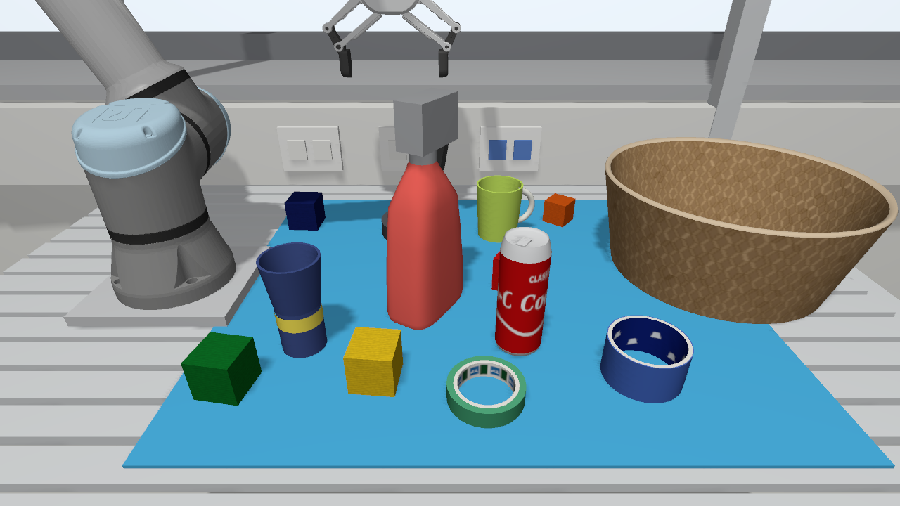

# all_on_table

The default scene of the simulation started by `run/sim.sh`: all
twelve items on the blue board, the basket empty, the gripper empty, which is
what the goal console (`run/goals.sh`) assumes at its start. Generated
with seed 1 for the cell of 2026-10-18 (slatted table, 0.70 x 0.59 m board;
stable layout settled in Gazebo, every item graspable):

    ros2 run lab_replica generate_problem.py --seed 1 --name all_on_table --basket-items 0 --p-holding 0 --max-actions 4



The items' positions do not matter to the consoles (the robot finds the
items and the basket itself); the table below is only for setting up the
same layout.

## The same layout on the real table (optional)

Place the items as in [`layout.png`](layout.png) and the table below (world
frame: origin on the table surface under the robot base axis, x to the right
as seen from the front of the table, y towards the wall; yaw about the
vertical from +x). The basket's centre is at (77.5, 6.0) cm. The robot finds the items
itself, so a few centimetres off is fine.

| # | Item | Where | Resting pose | x [cm] | y [cm] | yaw [deg] |
|---|---|---|---|---|---|---|
| 1 | blue-block | table | flat | 12.9 | 19.8 | 87 |
| 2 | blue-cup-with-yellow-stripe | table | upright | 20.6 | -12.2 | 18 |
| 3 | green-block | table | flat | 14.1 | -19.1 | 170 |
| 4 | green-mug | table | upright | 46.0 | 16.1 | 10 |
| 5 | orange-block | table | flat | 57.2 | 21.2 | -127 |
| 6 | red-block | table | flat | 47.2 | 0.4 | -27 |
| 7 | red-can | table | upright | 46.1 | -12.2 | -122 |
| 8 | red-spray-bottle | table | upright | 34.9 | -4.0 | 59 |
| 9 | roll-of-black-tape | table | flat | 31.7 | 16.9 | -71 |
| 10 | roll-of-blue-tape | table | flat | 59.2 | -17.3 | -39 |
| 11 | roll-of-green-tape | table | flat | 41.7 | -20.7 | -100 |
| 12 | yellow-block | table | flat | 30.0 | -18.1 | -5 |

## As generated

**Initial state:** 12 items on the table, (robot-gripper-empty)

**Goal:** (in-basket green-block) (robot-gripping red-block)

**Optimal plan (3 actions):**

1. (pick-up green-block)
2. (put-in-basket green-block)
3. (pick-up red-block)

## Run it

In simulation (two terminals):

```console
ros2 launch lab_replica sim.launch.py problem:=all_on_table_new
ros2 run lab_replica run_solution.py all_on_table_new
ros2 run lab_replica check_goal.py all_on_table_new      # afterwards: does the simulated scene satisfy the goal?
```

On the real robot, first set the items up as below, then:

```console
ros2 launch lab_replica real.launch.py         # then press Play on the teach pendant
ros2 run lab_replica run_solution.py all_on_table_new --speed-scale 0.3 --step
```

`run_solution.py` first offers to move the arm to the start pose
`[3.2603, -1.9843, 1.8579, -1.4445, -1.5708, 0.1187]` (joint angles in rad) if it is not there.

## Setting it up on the real table

Place the items as in [`layout.png`](layout.png) and the table below. The
coordinates are in the world frame: origin on the table surface under the
robot base axis, x to the right as seen from the camera, y towards the wall.
The yaw is the item's rotation about the vertical axis, from +x: for a block
the direction of one face normal, for the mug the direction of its handle,
for the spray bottle the direction of its nozzle. Round items can stand at
any yaw. The basket's centre is at (77.5, 6.0) cm.

| # | Item | Where | Resting pose | x [cm] | y [cm] | yaw [deg] |
|---|---|---|---|---|---|---|
| 1 | blue-block | table | flat | 12.9 | 19.8 | 87 |
| 2 | blue-cup-with-yellow-stripe | table | upright | 20.6 | -12.2 | 18 |
| 3 | green-block | table | flat | 14.1 | -19.1 | 170 |
| 4 | green-mug | table | upright | 46.0 | 16.1 | 10 |
| 5 | orange-block | table | flat | 57.2 | 21.2 | -127 |
| 6 | red-block | table | flat | 47.2 | 0.4 | -27 |
| 7 | red-can | table | upright | 46.1 | -12.2 | -122 |
| 8 | red-spray-bottle | table | upright | 34.9 | -4.0 | 59 |
| 9 | roll-of-black-tape | table | flat | 31.7 | 16.9 | -71 |
| 10 | roll-of-blue-tape | table | flat | 59.2 | -17.3 | -39 |
| 11 | roll-of-green-tape | table | flat | 41.7 | -20.7 | -100 |
| 12 | yellow-block | table | flat | 30.0 | -18.1 | -5 |

The grasps tolerate placement errors of about ±1.5 cm (the fingers open
16 mm beyond the item on both sides). If you place an item elsewhere, edit
its `xyz` (x, y) and `yaw_deg` in [`layout.yaml`](layout.yaml) and run
`ros2 run lab_replica replan_problem.py all_on_table_new`; check the new plan in
simulation before running it on the robot.
